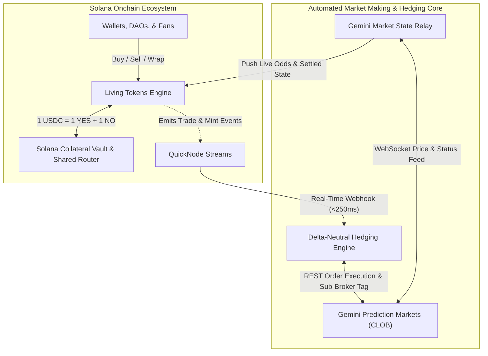

> **Current direction (2026-11-17): the project is now "Given"** — "money back
> if…" bets on Gemini prediction markets, placed as real orders in the user's own
> Gemini account. Start with [`CLAUDE.md`](CLAUDE.md), then
> [`docs/GIVEN.md`](docs/GIVEN.md), [`docs/PLAN.md`](docs/PLAN.md) and
> [`executor/README.md`](executor/README.md). The working code is on the
> `feat/gemini-executor` branch.
>
> Everything below is the earlier "Living Tokens" draft, kept for reference. It
> has not been updated and should not be read as the current plan.

# ⚡ Living Tokens
### *A Gemini Prediction Market Becomes an Economy You Can Hold, Trade, and Build On.*

[](https://solana.com/)
[](https://www.gemini.com/)
[](https://www.quicknode.com/)
[](https://opensource.org/licenses/MIT)

---

## 🎯 Executive Summary & The Pitch

> **Living Tokens are programmable Solana assets that react to Gemini’s live prediction markets. Tokens, collectibles, and community applications share one unified underlying liquidity pool, while their financial demand flows directly back to Gemini through real market-making and automated hedging.**

Prediction markets represent the most accurate forward-looking pricing of truth in the world. However, they are traditionally trapped in static trading interfaces designed for institutional orderbook traders. 

**Living Tokens solves this by transforming any Gemini prediction market into a living onchain community economy:**
- A community token whose **balance and metadata visually swell with market belief**.
- An underdog stamp that **immutably proves you believed when the odds were sub-10%**.
- A trophy that **autonomously moves itself to the victor's treasury upon settlement**.

### 💡 The Central Innovation: Shared Canonical Liquidity
**A creator should never have to bootstrap a new financial market to launch a new expressive token behavior.**

Instead of fragmenting liquidity across dozens of isolated AMM pools, **every living asset connected to a Gemini event shares the exact same funded collateral claims (`1 USDC ↔ 1 YES + 1 NO`)**. 

```
                                      ┌───► $HORNS (Liquid Community Token)
                                      │
[ 1 USDC Collateral Vault ] ◄──► [ Canonical YES/NO Claims ] ───┼───► Underdog Stamp (Wrapped Collectible)
                                      │
                                      └───► Autonomous Victory Trophy
```

All user demand routes into this shared engine, collapsing fragmented consumer derivatives into a single net directional risk profile that is **automatically hedged on Gemini**.

---

## 🏛️ The Three Living Objects

| Object | Asset Type | What Changes with Gemini Odds | Financial Backing |
| :--- | :--- | :--- | :--- |
| **$HORNS** | SPL Token-2022 (Scaled UI Amount) | **Balance & Metadata Swell/Shrink**: Wallet display reflects live belief; visual aura shifts through Underdog → Contender → Champion tiers. | 1:1 backed by canonical YES outcome claims (redeemable for 1 USDC on win). |
| **Underdog Stamp** | Wrapped NFT / Token-2022 Non-Fungible | **Mint Eligibility & Provenance**: Only mintable when Gemini odds are <10%. Permanently seals the exact entry odds and timestamp into the metadata. | Wraps 100 YES claims inside. 1-click unwrap back to liquid claims at any time. |
| **The Trophy** | Escrowed Autonomous NFT + Prize Vault | **Ownership Destination**: Programmatic Solana escrow automatically releases the Trophy and cash pot to the winner's treasury upon Gemini resolution. | Escrowed cash prize + commemorative championship NFT. |

---

## 🔄 How Value Accrues Back to Gemini

The core thesis of Living Tokens is that **Solana is the distribution and retail engagement layer, while Gemini is the institutional execution and liquidity engine.**



### 1. Direct Taker Volume & Fee Accrual
When users buy $HORNS or mint Underdog Stamps, the Solana Vault accumulates net directional imbalance (e.g., long Texas YES). The Hedge Engine immediately executes matching taker orders on Gemini's Central Limit Order Book (CLOB), generating **direct taker trading fees** for Gemini.

### 2. Orderbook Deepening (Two-Sided Resting Liquidity)
To minimize spread costs for Solana users, the Market Maker maintains resting limit bids and asks on Gemini. This deepens Gemini's orderbook, narrows market spreads, and helps qualify for Gemini's **Liquidity Rewards Program**.

### 3. Sub-Broker Attribution (`living-tokens-v1`)
Every order sent to Gemini's API carries a dedicated partner identifier header (`gemini-client: living-tokens-v1`). Gemini can cryptographically and programmatically attribute 100% of the institutional volume and retail flow generated by our platform.

### 4. Retail Distribution for Gemini's Event Catalog
Gemini gains access to sports fans, NFT collectors, and Web3 communities who would never otherwise open a traditional trading terminal. Every event Gemini lists becomes an immediate playground for community tokens and collectibles.

---

## ⚙️ Technical Architecture

### 1. Solana Smart Contract (`Anchor` + `SPL Token-2022`)
- **Split / Merge Core**: Implements standard binary outcome token mechanics.
  $$\text{Deposit } 1\ \text{USDC} \longrightarrow 1\ \text{YES Claim} + 1\ \text{NO Claim}$$
  $$\text{Merge } 1\ \text{YES Claim} + 1\ \text{NO Claim} \longrightarrow 1\ \text{USDC}$$
- **Token-2022 `ScaledUiAmount` Extension**: Enables the swelling balance visual effect. The user's underlying claim count remains fixed (guaranteeing 100% solvency), while the displayed UI balance expands and contracts with Gemini's live probability multiplier.
- **Dynamic Metadata Pointer**: The token metadata URI updates dynamically across tier thresholds (Underdog, Contender, Favorite, Winner).
- **Underdog Stamp Mint Guard**: Enforces an onchain invariant checking the current Oracle Relay timestamp and odds before permitting a stamp to mint.

### 2. QuickNode Streams Integration
- QuickNode Streams monitors the Solana Living Tokens Program ID on mainnet/devnet.
- Any `ClaimPurchased`, `StampMinted`, or `ClaimRedeemed` instruction triggers an immediate webhook to the Hedge Engine.
- Sub-second delivery guarantees the hedge is placed on Gemini before adverse price movements occur.

### 3. Gemini Market State Relay
- Connects to Gemini's prediction market WebSocket stream (`wss://api.gemini.com/v1/marketdata`).
- Relays price observations, bid/ask depth, and final resolution events (`Closed`, `Settled`, `Invalid`) onchain to Solana.

---

## 📊 Lifecycle Walkthrough: Texas Longhorns Game

```
   [ Texas at 8% ] ──► [ Texas Comeback: 35% ] ──► [ Fourth Quarter: 70% ] ──► [ Final Whistle: YES ]
         │                        │                           │                         │
  • $HORNS in Underdog     • $HORNS visual balance    • $HORNS in Favorite      • Gemini settles YES
    state                    swells 4.3x                state                   • 1 $HORNS = 1 USDC
  • Underdog Stamp mint    • Underdog Stamp mint      • Maker deepens Gemini      redemption
    window OPEN              CLOSES                     resting quotes          • Trophy moves to
  • Maker hedges delta     • Provenance locked for                              Texas Treasury
    on Gemini                early minters                                      • Hedger reconciles
```

---

## 🛠️ Repository Roadmap & Contents

```
├── programs/
│   └── living_tokens/       # Solana Anchor program (Vault, Claims, Stamps, Escrow)
├── hedge-engine/            # QuickNode Stream listener & Gemini execution bot
├── relay/                   # Gemini WebSocket listener & Solana Oracle publisher
├── app/                     # Next.js frontend with live Solana wallet & odds visualization
└── docs/
    ├── ARCHITECTURE.md      # In-depth technical specification & data structures
    ├── GEMINI_VALUE_ACCRUAL.md # Detailed economic analysis & fee modeling
    └── DEMO_WALKTHROUGH.md  # 3-minute hackathon judge demo script
```

---

## 🏆 Why Living Tokens Wins the Hackathon
1. **True Innovation**: Moves beyond boring betting screens to create interactive, dynamic onchain assets with emotional and financial resonance.
2. **Economic Coherence**: No unbacked algorithmic rebasing; 100% backed by segregated USDC collateral and delta-hedged on Gemini.
3. **Genuine Mutual Value**: Directly aligns with Gemini's strategic goal of expanding prediction-market trading volume and institutional liquidity.
4. **Native Solana Power**: Leverages cutting-edge Solana features (SPL Token-2022 Extensions, Scaled UI Amount, QuickNode Streams).
